<p align="center">
  
</p>

<p align="center">
  <strong>ENGENHARIA PARA FUNCIONAR. DESIGN PARA MARCAR.</strong><br />
  <sub>Sistemas web · Experiências digitais · Automação com IA</sub>
</p>

<br />

### `01 / QUEM SOU`

Sou **SonyYNee**. Transformo operações complexas em sistemas claros e ideias em produtos que as pessoas conseguem usar.

Construo painéis de gestão, ferramentas de gestão e experiências web com atenção à interface, às regras de negócio e à evolução do código. Meu ponto de encontro é entre **design, engenharia e inteligência artificial**.

<br />

### `02 / ARENA DE CONTRIBUIÇÕES`

<p align="center">
  
</p>

<p align="center">
  <sub>Meu histórico virou uma arena. A cobrinha se alimenta dos dias em que construí algo.<br />
  Animação do calendário de contribuições visíveis no GitHub.</sub>
</p>

<br />

### `03 / O QUE CONSTRUO`

| Interfaces | Sistemas | Inteligência |
| :--- | :--- | :--- |
| Experiências web com identidade, clareza e atenção aos detalhes. | Painéis, finanças, documentos e operações conectadas. | Automações e ferramentas de IA aplicadas ao desenvolvimento. |

<br />

### `04 / FERRAMENTAS`

```text
INTERFACE     HTML · CSS · JavaScript
SERVIDOR      Node.js · SQLite · APIs
FLUXO         Git · GitHub · Playwright · IA
PRINCÍPIO     Construir → testar → refinar → evoluir
```

<br />

<p align="center">
  <strong>O próximo nível começa no próximo commit.</strong><br />
  <sub>Criado para marcar. Construído para evoluir.</sub>
</p>
