  

  <strong>Interfaces bem pensadas. Sistemas que resolvem.</strong> 
  Transformando ideias em experiências digitais claras, bonitas e funcionais.

 

### Olá, eu sou SonyYNee 👋

Desenvolvo projetos digitais com atenção ao que acontece dos dois lados da tela: a experiência de quem usa e a estrutura de quem mantém.

Meu trabalho passa por **dashboards, sistemas de gestão e landing pages**, conectando design, regras de negócio e automação. Gosto de simplificar operações complexas e construir produtos que possam continuar evoluindo.

 

<table>
  <tr>
    <td width="33%" valign="top">
      <h3>01 · Interface</h3>
      
Design com propósito, navegação direta e cuidado com os detalhes.

    </td>
    <td width="33%" valign="top">
      <h3>02 · Produto</h3>
      
Gestão, documentos, finanças e processos conectados em um só lugar.

    </td>
    <td width="33%" valign="top">
      <h3>03 · Evolução</h3>
      
Automação, testes e código documentado para seguir construindo.

    </td>
  </tr>
</table>

 

### Na bancada

- **Sistemas de gestão** — operações, indicadores, cadastros e rotinas financeiras.
- **Experiências web** — páginas responsivas com identidade e foco na clareza.
- **Automação com IA** — ferramentas para organizar conhecimento e acelerar o desenvolvimento.

### Ferramentas que fazem parte dos meus projetos

  
  
  
  
  
  

 

  Design com intenção · Engenharia com cuidado · Evolução constante

